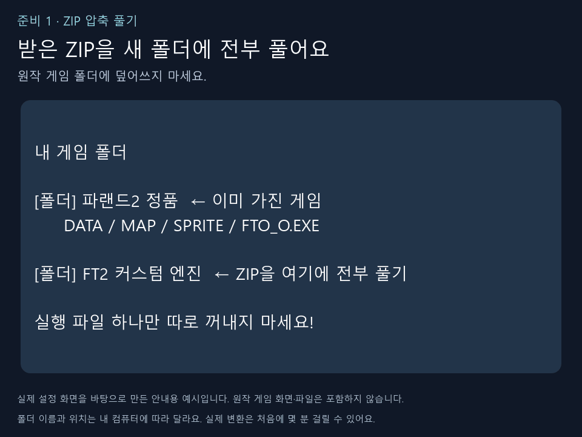
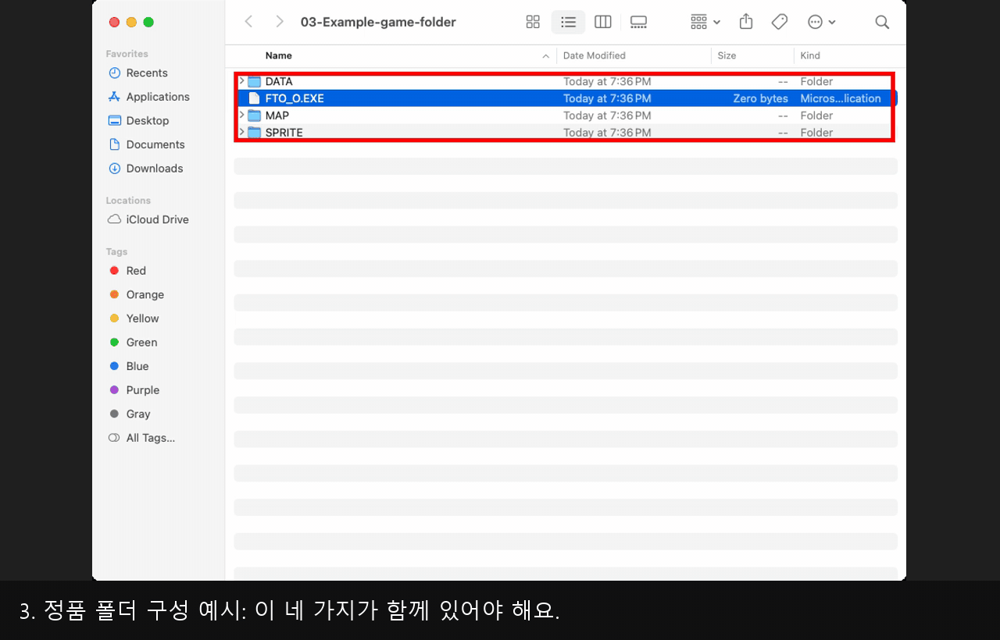

# 빨간 네모를 따라 하는 실제 폴더 안내

실제 파일 관리자의 폴더 화면과 실제 앱 설정 창을 순서대로 캡처했습니다.
**빨간 네모 안의 파일이나 버튼**을 찾아 아래 순서대로 누르면 됩니다.

## Windows용 파일: 압축 풀기부터 실행까지

[Windows 순서 MP4 영상](usage-guide.mp4)

1. 받은 `FT2-Windows-x64.zip`을 **전부** 압축 풉니다.
2. 압축을 푼 `FT2-Windows-x64` 폴더로 들어갑니다.
3. **`Launch-Windows.cmd`**를 두 번 클릭합니다.
4. 앱에서 **폴더 선택**을 누릅니다.
5. `DATA`, `MAP`, `SPRITE`, `FTO_O.EXE`가 함께 있는 정품 폴더를 고릅니다.
6. **게임 준비하기**를 누르고 끝날 때까지 기다립니다.
7. 준비가 끝나면 **연결하고 실행**을 누릅니다.

Windows 파일 목록은 호스트 PC가 아닌 격리된 WSL 가상화면의 실제 파일 관리자에서
촬영했습니다. Windows 탐색기와 창 모양은 다를 수 있지만 빨간 네모의 파일 이름은 같습니다.

## Mac M1 이상: 실제 Finder 화면

[Mac 순서 MP4 영상](usage-guide-mac.mp4)

1. 받은 `FT2-External-macos-arm64.zip`을 두 번 클릭합니다.
2. 압축이 풀린 폴더의 **FT2 External Engine 앱**을 두 번 클릭합니다.
3. 앱에서 **폴더 선택 → 게임 준비하기 → 연결하고 실행** 순서로 진행합니다.

Mac 폴더 사진은 별도 Apple Silicon 가상기기의 실제 Finder를 촬영했습니다.
설정 화면은 공통 앱 화면입니다. 정품 폴더 구성은 빈 예시 폴더로 보여 주며 원작 파일이나
게임 화면은 포함하지 않습니다. 실제 변환과 게임 실행을 녹화한 검증 영상은 아닙니다.
실제 첫 준비에는 몇 분이 걸릴 수 있습니다.

## 나중에 설정을 다시 바꾸려면

게임을 닫은 뒤 함께 들어 있는 **Game-Setup-Windows.cmd** 또는
**Game-Setup-Mac.command**를 열면 정품 폴더와 모드 설정을 다시 고를 수 있습니다.

## 안내를 다시 만드는 개발자

`tools/guide/capture_virtual_folders.py`와 `capture_setup_virtual.py`는 격리된 Xvfb에서
실제 파일 관리자·설정 창을 캡처합니다. 호스트 데스크톱을 사용하지 않습니다.
Mac Finder 캡처는 수동 CI의 `macos-folder-guide.yml`을 사용합니다.

원본 PNG는 공개하지 않고 검수용 개인 폴더에 보존합니다. 검수한 원본과 좌표를
`compose_folder_guide.py`에 주면, 원본은 바꾸지 않고 영상 필터로 크롭·가림·빨간 네모와
하단 설명을 합성합니다. 원작 데이터나 폰트 파일은 배포하지 않습니다.
